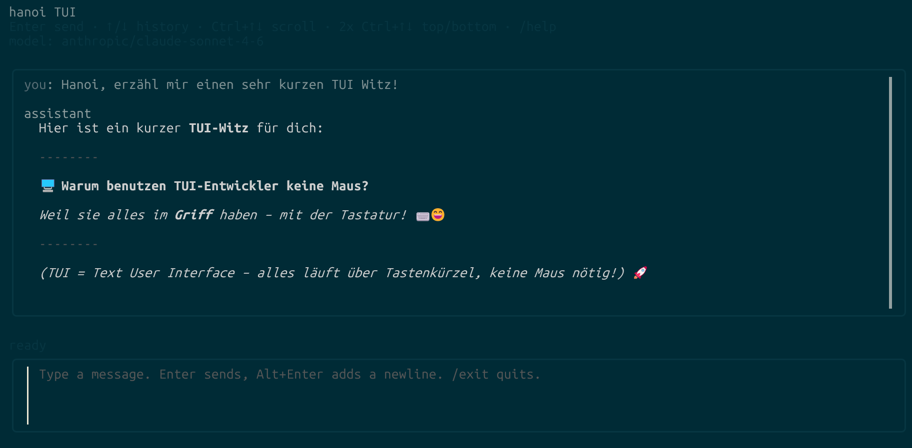

# hanoi

Basic AI harness in Go.

## Features

- CLI prompt interface
- streaming output with `-stream`
- conversation memory with `-memory`
- config via `.env`
- provider override via `OPENAI_BASE_URL`
- multiple OpenAI-compatible providers in `hanoi.json[c]`, with CLI and TUI model selection
- GitHub Copilot provider with OAuth2 device login in the CLI and TUI
- works as a simple OpenAI-compatible harness
- includes OpenAI-style tool calling with a local `bash` tool
- optional API logging with `-log <file>`
- live Hanoi Trace timeline in the TUI and optional structured JSONL export with `-trace <file>`
- MCP tools from local and remote servers, with OpenCode-compatible config and `/mcps` management
- tag-based `-version` output and GitHub Actions builds for Linux, macOS, and Windows

## Code structure

Hanoi uses one Go module with focused internal packages:

```text
main.go              CLI entry point
version.go           Build-time version (main.version)
internal/
  app/               Application wiring, agent loop, API client, MCP and TUI
  config/            Provider settings and OpenCode-compatible config loading
  doctor/            Local runtime and writable-storage checks
  tools/             Bash execution, process cancellation and tool-result storage
  trace/             Lifecycle events, run correlation and JSONL recording
```

Tests live alongside the package they cover; end-to-end agent/tool and TUI tests
are in `internal/app`. The tools and trace packages are independent of the TUI,
provider configuration and MCP implementation.

## Setup

For GitHub Copilot, log in once and start the TUI:

```bash
hanoi.exe -auth github-copilot
hanoi.exe -tui
```

The saved Copilot login is used automatically when no other provider or OpenAI
environment settings are selected. In the TUI, `/models` discovers available
Copilot models; use `↑`/`↓` and `Enter` to activate one. `hanoi.exe -models`
lists them directly in the terminal. See [Windows: install or update Hanoi](#windows-install-or-update-hanoi)
for installation, and [GitHub Copilot (OAuth2)](#github-copilot-oauth2) for details.
When running from source, replace `hanoi.exe` with `go run .`.

For an OpenAI API key, create a `.env` file:

```bash
OPENAI_API_KEY=your_key_here
OPENAI_MODEL=gpt-4o-mini
OPENAI_BASE_URL=https://api.openai.com/v1/chat/completions
```

Environment variables still work too.

OpenAI `gpt-6-astra` and `gpt-6.1-sol` require the Responses API for function
calling. Hanoi automatically uses `/v1/responses` for these models on
`api.openai.com`, including when `OPENAI_BASE_URL` is the usual Chat Completions
URL. Reasoning remains enabled; Bash/MCP tools, streaming and tool follow-up
rounds are supported. Other compatible providers can opt in by setting their
base URL to the full `/responses` endpoint. Responses requests use `store: false`
and pass encrypted reasoning items back within the current tool loop.

If a Chat Completions provider explicitly rejects function tools combined with
reasoning and instructs Hanoi to set `reasoning_effort` to `none`, Hanoi retries
that request once with `reasoning_effort: "none"`. Bash and MCP tools remain
enabled. The retry is shown in the TUI status and API log; other API errors are
returned normally. This applies to streaming and non-streaming requests, including
environment-only configuration.

### Windows: install Bash

Hanoi's built-in tool runs commands using `bash -lc`. **Bash must be installed
and `bash.exe` must be available on `PATH`**, including when starting Hanoi from
PowerShell or Command Prompt. PowerShell alone does not provide Bash.

Install [Git for Windows](https://gitforwindows.org/), which includes Git Bash.
You can also install it from PowerShell using WinGet:

```powershell
winget install --id Git.Git -e --source winget
```

After installation, start Hanoi from **Git Bash**, or add the Git Bash executable
directory to your PowerShell session's `PATH` (adjust for your installation):

```powershell
Test-Path "C:\Program Files\Git\bin\bash.exe"
$env:Path = "C:\Program Files\Git\bin;$env:Path"
Get-Command bash
.\hanoi.exe -tui
```

The `PATH` change above applies only to the current PowerShell session. To make
it persistent, add `C:\Program Files\Git\bin` to your user `Path` in Windows
Environment Variables and open a new terminal. Run `/doctor` in Hanoi to verify
that Bash is detected. If it reports `executable not found in PATH`, Bash is
not yet accessible to the Hanoi process.

**Do not confuse Git Bash with Windows' `bash.exe` launcher.** In Command
Prompt, check which executable a plain `bash` command starts:

```cmd
where bash
```

`C:\Windows\System32\bash.exe` is a WSL launcher, not Git Bash. A result
under `Microsoft\WindowsApps` is also not the Git for Windows installation.
To explicitly start Git Bash from Command Prompt, use:

```cmd
"C:\Program Files\Git\bin\bash.exe" --login -i
```

Then, in that Git Bash session, log in to Copilot and start the Windows
executable from its directory:

```bash
./hanoi.exe -auth github-copilot
./hanoi.exe -tui
```

For OpenAI API-key authentication, set the key instead:

```bash
export OPENAI_API_KEY="your_key_here"
./hanoi.exe -tui
```

Git Bash normally reports `MINGW64_NT-...` or a similar Windows name for
`uname -s`; `Linux` indicates a Linux environment. Starting a Windows executable
from WSL can require explicit environment forwarding, even after `export`, and
can otherwise cause `OPENAI_API_KEY is not set`. The Git Bash commands above
pass the exported key directly to the Windows executable. `OPENAI_MODEL` and
`OPENAI_BASE_URL` are optional; their defaults are `gpt-4o-mini` and
`https://api.openai.com/v1/chat/completions`.

### Windows: install or update Hanoi

After installing Git for Windows as described above, open Git Bash and create
a directory for the executable:

```bash
mkdir -p ~/bin
```

Add it to `PATH` once, then reload your shell settings:

```bash
echo 'export PATH="$HOME/bin:$PATH"' >> ~/.bashrc
source ~/.bashrc
```

Download the latest Windows x64 release:

```bash
curl -fL -o ~/bin/hanoi.exe https://github.com/eumel8/hanoi/releases/latest/download/hanoi-windows-amd64.exe
```

On Windows ARM64, use `hanoi-windows-arm64.exe` in the URL instead.
Available versions and their binaries are listed on the
[releases page](https://github.com/eumel8/hanoi/releases).

Make the file executable in Git Bash and check the installed version:

```bash
chmod +x ~/bin/hanoi.exe
hanoi.exe -version
```

The output is `hanoi v<installed-version>`. To update, close running Hanoi
instances and repeat the download command, which replaces `~/bin/hanoi.exe`.
OAuth credentials are stored separately and remain available after updating.
Model discovery requires a build that includes the discovery feature; check the
release notes if your version does not recognize `-models`.

Log in once with your GitHub Copilot account, then discover models and start:

```bash
hanoi.exe -auth github-copilot
hanoi.exe -models
hanoi.exe -tui
```

Follow the GitHub URL and enter the code shown by the login command. Subsequent
starts need only `hanoi.exe -tui`. In the TUI, `/models` loads the account's
available compatible models; select one with `↑`/`↓` and `Enter`, or press `r`
to refresh the list. `/doctor` checks that the Bash tool is ready.

To select a model explicitly, for example when other provider settings exist:

```bash
hanoi.exe -tui -model github-copilot/gpt-4.1
```

The commands above use Git Bash. In PowerShell, an executable in the current
directory is started with `.\hanoi.exe`; the Git Bash executable directory must
also be on `PATH` for Hanoi's Bash tool.

## Run

Single prompt:

```bash
go run . "Sag hallo auf Deutsch"
```

Streaming:

```bash
go run . -stream "Erzähl einen kurzen Witz"
```

Conversation memory:

```bash
go run . -memory chat1 "Mein Name ist Eva"
go run . -memory chat1 "Wie heiße ich?"
```

TUI chat mode:

```bash
go run . -tui
go run . -tui -memory chat1
```

Inside TUI:

- `Enter` sends
- `Alt+Enter` inserts a newline
- `Esc Esc` (twice consecutively within one second) stops the current model
  request and active Bash/MCP tool call, and skips remaining tools and follow-up
  requests. The session stays open; the prompt and any text already received
  remain in the conversation. Wait for `Stopped.` before sending the next prompt.
  Bash process trees are terminated; MCP calls receive cancellation (remote
  servers must cooperate). Work already performed by tools is not undone.
- `↑`/`↓` recalls earlier prompts and slash commands at the first/last input line;
  `Alt+↑`/`Alt+↓` recalls them from anywhere, preserving the current draft
  (session history, seeded from saved user messages when using `-memory`)
- `PgUp`/`PgDown` or the mouse wheel scrolls the chat; `Ctrl+Home`/`Ctrl+End`
  jumps to the beginning/end, with a scrollbar showing the current position
- assistant responses stream live in the TUI
- scrolling up pauses automatic following until you return to the bottom
- Markdown headings, lists, tables, and syntax-highlighted code blocks render live,
  with wrapping adjusted to the terminal width and colors for light or dark backgrounds
- `/exit` or `/quit` ends the session
- `/clear` resets the current conversation
- `/save` writes memory to disk
- `/model <provider/model>` switches provider and model (`/model <name>` switches within the active provider)
- `/providers`, `/models`, or `/model` opens the provider/model picker and discovers Copilot models; `r` refreshes the list
- `/connect github-copilot` logs in to GitHub Copilot; `/logout github-copilot` removes its local login
- `/system <text>` sets the system prompt
- `/mcps` opens MCP server management
- `/trace` or `Ctrl+T` toggles the live trace timeline, including while a response is running;
  `Esc` returns to chat and restores its scroll position
- `/doctor` checks the local runtime, storage, active model, configuration/log paths,
  and the current MCP connection/tool catalog; `/doctor provider` also tests the model endpoint
- `/help` shows commands



### Runtime diagnostics

Use `/doctor` in the TUI for a scrollable report. It checks whether Bash is in
`PATH`, verifies that the tool working directory and result storage are writable,
and displays the selected provider/model, configuration file, API log and trace
paths. Missing tool directories are created and temporary write probes are
removed. MCP diagnostics use the current connection state and list available
tool names; they do not reconnect servers or invoke tools.

`/doctor provider` additionally sends one small, tool-free chat request to the
active model, using the configured authentication and headers with a 20-second
timeout. This is a real model request and may incur provider charges. Success
requires a usable chat response, rather than just a reachable HTTP endpoint.
Credentials, raw provider error bodies and OAuth login URLs are omitted from
the report. Local-only `/doctor` makes no network requests.

Results use `OK`, `FAIL`, `WARN`, `SKIP` and `INFO` labels. Scroll as in chat and
press `Esc` to return. Diagnostic results do not enter the model conversation or
saved chat memory.

### Hanoi Trace

Trace shows the execution of each new turn: user input, provider/model requests,
response duration and tool-call count, Bash/MCP calls and arguments, execution
duration, Bash exit codes, errors/timeouts, and tool-result sizes passed back to
the model. Both streaming and non-streaming requests use the same event format.
Tool errors remain visible even when the model recovers and completes the turn.

```bash
go run . -tui -trace trace.jsonl
go run . -trace trace.jsonl "Inspect the current workspace"
go run . -stream -trace trace.jsonl "Inspect the current workspace"
```

The file is append-only JSONL (one event per line), created with mode `0600`.
Each event has a timestamp, run ID, turn number, sequence number and model
reference. Event types are `turn.started`, `model.started`, `model.completed`,
`tool.started`, `tool.completed`, `tool.result`, and `turn.completed`.
Durations are in milliseconds; output sizes are bytes before truncation and
result sizes are bytes after preparation for the next model request.
Sequence and turn numbers restart with each process; run IDs correlate events
across appended sessions. A completed turn means the model finished, not that
its claims were independently verified.

The TUI retains the latest 2,000 events for the current session; the file keeps
all events. Saved conversation history does not reconstruct earlier traces.
Trace includes prompts, tool arguments and errors, but omits credentials from
request headers and does not record complete model responses or tool output.
Use `-log api.log` for the existing full API-payload logging when needed.

Build:

```bash
go build
./hanoi -version
./hanoi -tui -memory chat1
```

## Versions and release builds

`hanoi -version` prints the embedded version and exits without loading `.env`,
requiring an API key, or connecting to MCP servers. For example, a build from tag
`v1.2.3` prints `hanoi v1.2.3`. A plain `go build` without version injection prints
`hanoi dev`.

To embed the current Git version in a local build (Bash):

```bash
go build -trimpath -ldflags "-X main.version=$(git describe --tags --always --dirty)" -o hanoi .
```

`.github/workflows/build.yml` runs on branch/tag pushes, pull requests, and manual
dispatches. It runs race-enabled tests and `go vet` on Linux, then builds:

| Platform | Architectures | Binaries |
| --- | --- | --- |
| Linux | amd64, arm64 | `hanoi-linux-amd64`, `hanoi-linux-arm64` |
| macOS | amd64, arm64 | `hanoi-darwin-amd64`, `hanoi-darwin-arm64` |
| Windows | amd64, arm64 | `hanoi-windows-amd64.exe`, `hanoi-windows-arm64.exe` |

Builds use the Go version specified in `go.mod`, with CGO disabled. Each binary
and its `.sha256` checksum are available as workflow artifacts. Tag pushes embed
the exact tag and publish the files to a GitHub Release. Other builds use
`git describe --tags --always --dirty`, for example `v1.2.3-4-gabcdef0`.

To trigger a release after pushing the workflow:

```bash
git tag v1.2.3
git push origin v1.2.3
```

Downloaded Linux/macOS binaries may need `chmod +x` before running. The built-in
`bash` tool requires Bash at runtime, including on Windows (for example from Git
for Windows).

## MCP servers

Hanoi reads the `mcp` section of a config following
[the OpenCode schema](https://opencode.ai/config.json). It searches the current
workspace for `hanoi.json`, `hanoi.jsonc`, `opencode.json`, then `opencode.jsonc`
and uses the first file found. JSONC comments and trailing commas are supported.
You can select a file explicitly with `-config path/to/config.json`.
The same file can configure `provider` and `model` as described below.
Other OpenCode settings are ignored.

Start by copying `hanoi.json.example` to `hanoi.json`. Its example servers are
disabled initially and can be enabled through `/mcps` after configuration.

Current schema format:

```json
{
  "$schema": "https://opencode.ai/config.json",
  "mcp": {
    "timeout": { "startup": 10000, "catalog": 5000, "execution": 60000 },
    "servers": {
      "filesystem": {
        "type": "local",
        "command": ["npx", "-y", "@modelcontextprotocol/server-filesystem", "."],
        "disabled": false
      }
    }
  }
}
```

Local servers use MCP stdio. `command` is an executable/argument array, not a shell
string. Optional `cwd` resolves relative to the workspace, and `environment`
overrides inherited environment variables. The filesystem example requires
Node.js and `npx`.

Remote servers use `"type": "remote"`, `"url": "https://host/mcp"`, and optional
`headers` or OAuth authentication. Hanoi tries Streamable HTTP, then legacy SSE.
Use `{env:VARIABLE}` in commands, paths, environment values, URLs, or headers
to reference environment variables (including variables loaded from `.env`).
Set `"oauth": false` when using a static Authorization header. `codemode: true`
is not implemented; use direct MCP tools instead.

The legacy OpenCode format is also accepted:

```json
{
  "mcp": {
    "filesystem": {
      "type": "local",
      "command": ["npx", "-y", "@modelcontextprotocol/server-filesystem", "."],
      "enabled": true,
      "timeout": 10000
    }
  }
}
```

Timeouts are milliseconds. Per-server timeout objects override the global
`mcp.timeout` values. A legacy integer applies to startup, catalog, and execution.
Hanoi's defaults are 5000 ms for startup/catalog and 60000 ms for execution.
`protocol` supports `legacy` (default), `auto`, and `2026-07-28`.

### Managing servers with `/mcps`

```bash
./hanoi -tui -config hanoi.json -log debug.log
```

Type `/mcps` to open the server list with connection status, tool counts, and errors:

- `↑` / `↓`: select a server
- `Enter`: enable/connect or disable/disconnect the selected server
- `r`: reconnect and refresh the selected server's tools
- `t`: inspect tool names and descriptions
- `a`: authenticate with OAuth; `l`: log out
- `Ctrl+R`: reload the config and connections
- `Esc`: return to the chat

Commands are also available directly from the chat input:

```text
/mcps list
/mcps enable filesystem
/mcps disable filesystem
/mcps reconnect filesystem
/mcps tools filesystem
/mcps reload
/mcps auth remote-oauth-example
/mcps logout remote-oauth-example
```

Enable/disable changes apply to the current process. Edit `disabled` (or legacy
`enabled`) in the config to persist the startup state. Reloading applies the
file's settings; a config syntax error preserves existing connections.

Connected servers' tools are automatically advertised alongside `bash` in CLI,
streaming, and TUI chat requests. Tools receive stable, namespaced API names to
avoid collisions. MCP results, including structured content and tool errors,
are sent back to the model. Startup failures are visible in `/mcps` and do not
prevent other servers from being used. Connections and local processes are closed
when Hanoi exits. With `-log`, MCP connection events, local stderr, tool calls,
and results are logged as well as the model API traffic.

### Interactive OAuth

For a remote MCP server requiring OAuth, omit `oauth` or set it to `{}`:

```json
{
  "$schema": "https://opencode.ai/config.json",
  "mcp": {
    "servers": {
      "my-service": {
        "type": "remote",
        "url": "https://your-service.example/mcp",
        "oauth": {}
      }
    }
  }
}
```

An unauthorized server shows `needs_auth` in `/mcps`. Select it and press
`Enter` or `a`, or run `/mcps auth my-service`. Hanoi discovers the OAuth
authorization server, dynamically registers a public client if needed, opens
the browser, and completes the Authorization Code flow with PKCE. After login,
Hanoi connects the MCP server and discovers its tools. OAuth works with both
Streamable HTTP and legacy SSE.

The login URL is also shown in `/mcps` if the browser cannot be opened. Login
waits up to three minutes and can be cancelled with `Esc`. The callback defaults
to `http://127.0.0.1:19876/mcp/oauth/callback`; the browser must be able to reach
that loopback address (use port forwarding when running Hanoi over SSH).

If the authorization provider needs an existing client registration, configure:

```json
"oauth": {
  "client_id": "{env:MCP_CLIENT_ID}",
  "client_secret": "{env:MCP_CLIENT_SECRET}",
  "scope": "read write",
  "callback_port": 19876
}
```

`client_secret` is optional for public clients. `redirect_uri` can specify a
different loopback HTTP callback URL and takes precedence over `callback_port`;
register that exact URI with your provider. `auth_server_metadata_url` optionally
overrides the discovery document location. Legacy OpenCode `clientId`,
`clientSecret`, `callbackPort`, and `redirectUri` names are accepted too.

Tokens and refresh configuration are stored under
`$XDG_CONFIG_HOME/hanoi/mcp-oauth/` (normally `~/.config/hanoi/mcp-oauth/` on Linux).
The directory uses `0700`, token files use `0600`, and updates are atomic.
Sessions are scoped to the configured server URL and OAuth settings. Subsequent
starts reuse the login and refresh tokens automatically. If refresh fails or the
session expires, use `/mcps auth my-service` again. Tokens, client secrets,
authorization codes, and token endpoint responses are not written to the debug
log by the OAuth implementation.

`/mcps logout my-service` disconnects the server and deletes its local OAuth
session. It does not revoke authorization at the provider. Disable the server
separately if you also want to remove it from startup connections.

## API logging

Enable logging when debugging requests or tool-call follow-ups:

```bash
./hanoi -log hanoi.log "Nutze bash und zeige das aktuelle Verzeichnis"
./hanoi -tui -log hanoi.log
```

The log appends UTC timestamps, request JSON, HTTP status codes, and response
body chunks (including streaming responses and API error bodies). Response chunks
are quoted to preserve newlines. Authorization headers are not logged. Prompts,
conversation history, and tool output are included and can contain sensitive data.
New log files are created with owner-only read/write permissions (`0600`).
Logging is disabled unless `-log` is supplied.

## Providers

Configure multiple providers using the
[OpenCode custom-provider format](https://opencode.ai/docs/providers/#custom-provider).
Providers share the same JSON/JSONC file as MCP servers (`-config` also applies to
providers). For example:

```json
{
  "$schema": "https://opencode.ai/config.json",
  "model": "openai/gpt-4o-mini",
  "provider": {
    "openai": {
      "npm": "@ai-sdk/openai-compatible",
      "name": "OpenAI",
      "options": {
        "baseURL": "https://api.openai.com/v1",
        "apiKey": "{env:OPENAI_API_KEY}"
      },
      "models": {
        "gpt-4o-mini": { "name": "GPT-4o mini" }
      }
    },
    "ollama": {
      "npm": "@ai-sdk/openai-compatible",
      "name": "Ollama (local)",
      "options": { "baseURL": "http://localhost:11434/v1" },
      "models": {
        "qwen3-coder": { "name": "Qwen3 Coder" }
      }
    }
  }
}
```

`model` selects the startup provider/model. Override it for a single run:

```bash
go run . -model ollama/qwen3-coder "Hello"
go run . -tui -config hanoi.json
```

In the TUI, `/providers` or `/models` opens a sorted list with provider/model
display names and the active selection. Use `↑`/`↓` and `Enter` to switch, or
`Esc` to close. `/model ollama/qwen3-coder` switches directly. Switching applies
to subsequent requests and keeps the conversation; edit `model` in the file to
persist a default. If exactly one model is configured, it is selected automatically;
otherwise `model` or `-model` is required.

- Provider IDs are the keys of `provider`; model keys must match a configured model.
  A model's optional `id` overrides the model ID sent to the API. Model IDs can
  contain slashes, for example `gateway/vendor/model`.
- `options.baseURL` is an API base URL; Hanoi appends `/chat/completions`.
  A full Chat Completions endpoint is also accepted, including query parameters.
  The `openai` provider defaults to `https://api.openai.com/v1`.
- `options.apiKey` sets Bearer authentication. Omit it for unauthenticated local
  servers. The `openai` provider falls back to `OPENAI_API_KEY` when omitted.
- `options.headers` adds custom request headers and can override Authorization.
  Keys and header values support `{env:VARIABLE}`, including `.env` variables.
  Only the selected provider's variables are resolved, so an unused provider's
  missing credentials do not prevent startup.
- Hanoi uses OpenAI Chat Completions for all providers. `npm` may be omitted,
  `@ai-sdk/openai-compatible`, or `@ai-sdk/openai`; it is a compatibility marker,
  not an installed adapter. Native Anthropic, Bedrock, and other API protocols,
  and OpenCode's credential store are not supported. GitHub Copilot has built-in
  OAuth support as described below.

### GitHub Copilot (OAuth2)

Log in with GitHub's OAuth2 Device Authorization flow, using the same public
OAuth client as OpenCode:

```bash
go run . -auth github-copilot
go run . -model github-copilot/gpt-4.1 "Hello"
go run . -tui -model github-copilot/gpt-4.1
```

Hanoi displays a GitHub verification URL and a one-time code and opens the
browser. Enter the code and authorize access. No API key, client secret, or
localhost callback is required. `Ctrl+C` cancels CLI login. The GitHub account
must have Copilot access; model availability depends on the account and plan.

With a saved Copilot login and no other provider or OpenAI environment settings,
`hanoi.exe -tui` defaults to `github-copilot/gpt-4.1`. To choose a different
startup model or use Copilot alongside other providers, set the top-level model
in `hanoi.json` (use a model ID from `/models` or `hanoi.exe -models`):

```json
{
  "model": "github-copilot/gpt-4.1",
  "provider": {
    "github-copilot": {
      "name": "GitHub Copilot",
      "models": {
        "gpt-4.1": { "name": "GPT-4.1" },
        "gpt-5-mini": { "name": "GPT-5 mini" },
        "gpt-6.1-sol": { "name": "GPT-6.1 Sol" }
      }
    }
  }
}
```

The provider section is optional when using `-model github-copilot/<model>` or
a top-level Copilot model. `/models`, `/providers`, and `/model` automatically
load the available models from Copilot using your saved login. Discovery also
runs after a successful TUI login. Use `↑`/`↓` and `Enter` to select a model;
the list scrolls to keep the selection visible. Press `r` to refresh it.

List available models from the CLI without sending a chat request:

```bash
hanoi.exe -models
go run . -models
```

Discovery displays enabled chat models with a supported Chat Completions or
Responses endpoint, excluding models that explicitly disable tool calling.
It uses the account-specific API endpoint and preserves configured aliases and
display names for available models. The remote catalog supplies the correct
API route. No project configuration is rewritten. If discovery fails, the
existing list remains available and an error is shown; press `r` to retry.
Before discovery, the built-in picker offers `gpt-4.1` and `gpt-5-mini`.
You can still select model IDs directly with `/model github-copilot/<model>`.

Without catalog metadata, Copilot uses the following routing: GPT-5 and
newer (except `gpt-5-mini`), Grok, and MAI Code are routed to `/responses`;
other models use `/chat/completions`. Models that require native Anthropic
Messages are not supported by this integration.

In the TUI use `/connect github-copilot`, or press `a` in `/providers`. The code
and URL remain visible while waiting; `Esc` cancels. After connecting, select a
Copilot model. `/doctor provider` uses the saved OAuth session too. Requests
include Copilot's API version, intent and initiator headers, distinguishing user
prompts from agent/tool follow-up requests. Hanoi uses the account-specific API
endpoint reported by GitHub, falling back to `https://api.githubcopilot.com`.
An explicit `options.baseURL` overrides this endpoint. A full `/chat/completions`
or `/responses` URL also overrides automatic model routing.

The GitHub OAuth token is stored separately from project configuration under
`os.UserConfigDir()/hanoi/provider-oauth/github-copilot.json` (normally
`~/.config/hanoi/provider-oauth/github-copilot.json` on Linux). The directory uses
`0700`, the file uses `0600`, and writes are atomic. Later requests reuse the
saved login; OAuth responses and credentials are not written to the API log.
If GitHub expires or revokes the token, log in again. Hanoi does not read or
modify OpenCode's credentials. This flow currently supports GitHub.com accounts.

```bash
go run . -logout github-copilot
```

Alternatively use `/logout github-copilot` or press `l` in `/providers`. Logout
deletes the local session; it does not revoke the authorization on GitHub.

Without a `provider` section, the original `OPENAI_API_KEY`, `OPENAI_MODEL`, and
`OPENAI_BASE_URL` settings still work. `OPENAI_BASE_URL` continues to mean the
full endpoint URL in this mode. For example:

```bash
OPENAI_API_KEY=... OPENAI_MODEL=... OPENAI_BASE_URL=https://host/v1/chat/completions go run . "Hello"
```

## Tool calling

`hanoi` now sends an OpenAI-compatible `bash` tool with each request. If the model decides to call it, the command is executed locally via `bash -lc`, and the tool result is sent back to the model as a follow-up tool message.

Tool calling works in normal CLI mode, with `-stream`, and in the TUI. Streamed
tool-call fragments are assembled before execution, including multiple calls in
one response. The model's answer after tool execution appears in the chat;
the raw tool results can be inspected in the follow-up request in the API log.

Bash commands run in `/tmp/hanoi` by default (`os.TempDir()/hanoi` on other
platforms or when `TMPDIR` is set). The directory is created with `0700`
permissions. Configuration and conversation memory still use the launch directory.

Bash commands have a 30-second timeout. On Linux and macOS, a timeout stops the
whole command process group, including pipelines. The TUI status distinguishes
waiting for the model, receiving a response, and running a tool. Tool start/end
times are recorded with `-log`. The Bash tool description includes the working
directory and saved-results directory for follow-up questions.

Tool results larger than 32 KiB are saved in full under `/tmp/hanoi/tool-results/`
with owner-only file permissions (`0600`). The model receives a limited preview,
an explicit truncation notice, and the absolute file path so it can use `bash` to filter
or aggregate the full result. This applies to both MCP and Bash tools. Saved
results remain available after exit; remove them when no longer needed.

Example prompt:

```bash
go run . "Nutze das bash tool und gib mir die Dateien im aktuellen Ordner aus"
```

Conversation memory is stored in:

```bash
.hanoi/
```
